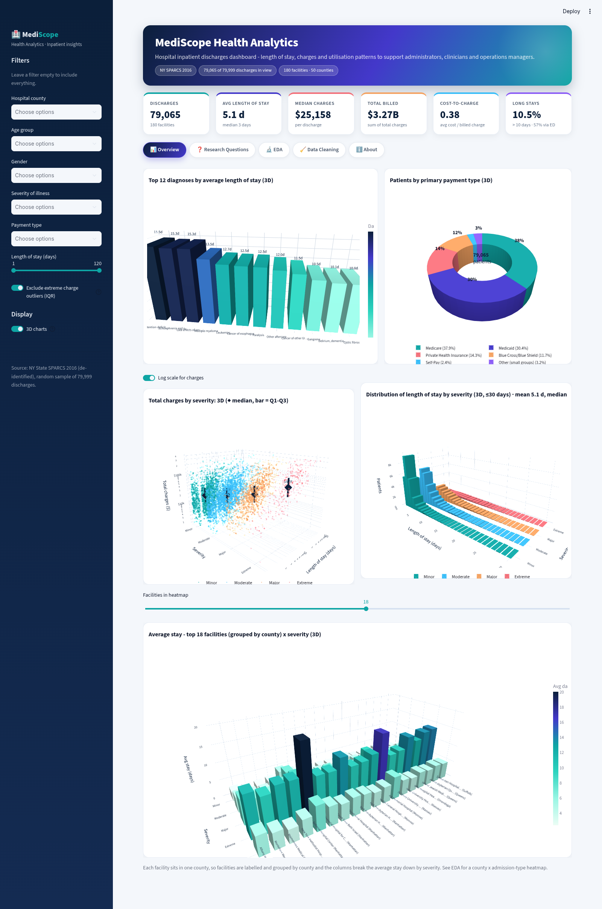
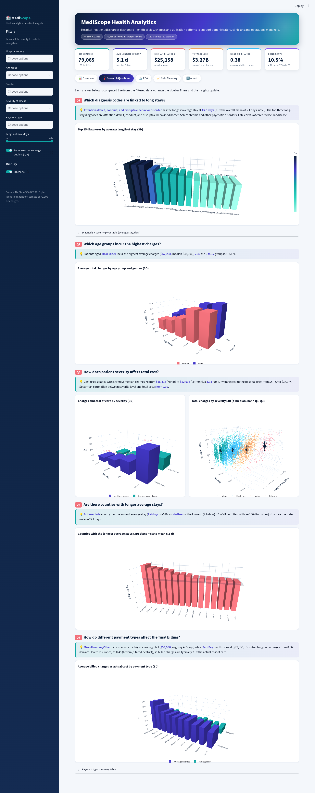
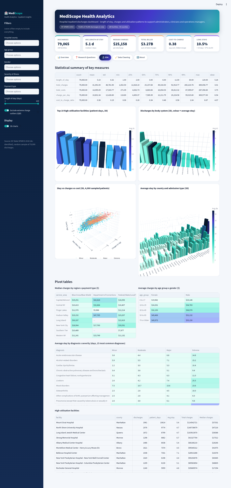
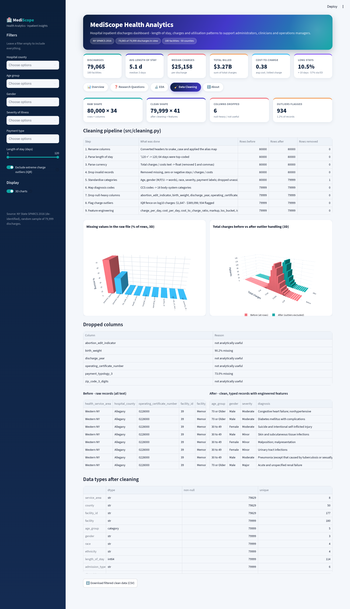

# 🏥 MediScope Health Analytics: Hospital Inpatient Discharges Dashboard

| | |
|---|---|
| **Student** | Dhwanan Bhatt |
| **Student ID** | 2505556 |
| **CRS** | Artificial Intelligence |
| **Course** | Mathematics for AI-II |
| **Scenario** | 2: Hospital Inpatient Discharges Dashboard |
| **Repository** | https://github.com/DHWANAN722/IADAI2022505556-DhwananBhatt |
| **Live app** | **🔗 `<ADD STREAMLIT CLOUD LINK HERE>`** |

---

## 1. Project overview

MediScope Health Analytics works with hospitals to improve patient care and operations through data.
This interactive **Streamlit** dashboard looks at hospital inpatient discharges (patient demographics,
diagnoses, severity of illness, length of stay, charges, costs and payer) so that **hospital administrators,
clinicians and operations managers** can see:

* which diagnoses and severity levels drive long stays and high costs,
* how charges differ by age group, gender, county, facility and payment type,
* which facilities have the highest utilisation (patient-days).

Every KPI, chart and insight sentence is **computed live from the data**. The sidebar filters change all of them.

## 2. Dataset

| | |
|---|---|
| Source | New York State Department of Health, **Hospital Inpatient Discharges (SPARCS De-Identified): 2016** |
| Dataset page | https://health.data.ny.gov/Health/Hospital-Inpatient-Discharges-SPARCS-De-Identified/gnzp-ekau |
| API used | `https://health.data.ny.gov/resource/gnzp-ekau.csv` (Socrata, dataset id `gnzp-ekau`) |
| Discharge year | 2016 (2,343,429 discharges in the full file) |
| Sample in repo | `data/raw/sparcs_2016_inpatient_sample.csv.gz`: **80,000 rows × 34 columns** (3.3 MB gzip) |
| Sampling | 1,600 randomly chosen pages × 50 rows (seed 42), spread across all 2.34 M records. Re-create with `python -m src.fetch_data` |

The columns match the assignment brief: age group, gender, race, CCS diagnosis code and description, APR severity,
length of stay (top-coded as `"120 +"`), hospital county, facility name, payment typology, birth weight (mostly
empty), total charges and total costs.

> **Using the course CSV instead:** put the file in `data/raw/`, set `DATA_PATH` in `src/config.py`, and add
> any differently named columns to `COLUMN_ALIASES` in the same file. Headers are snake_cased automatically
> (e.g. `"Total Charges"` → `total_charges`), so the original SPARCS headers work as they are.

## 3. Research questions & key insights

The figures below are for the **default view** (all filters open, 934 extreme-charge outliers excluded,
79,065 discharges). The app recomputes them for every filter combination.

| # | Question | Key insight (from the data) |
|---|---|---|
| Q1 | **Which diagnosis codes are linked to long stays?** | *Attention-deficit, conduct & disruptive behaviour disorders* have the longest average stay (**15.5 days**, 3.0× the overall mean of 5.1 days), followed by *Schizophrenia & other psychotic disorders* and *Late effects of cerebrovascular disease* (stroke rehab). Mental-health and rehabilitation diagnoses dominate the long-stay list. |
| Q2 | **Which age groups incur the highest charges?** | Patients **70 or older** have the highest average charges (**$52,238**, median $35,306), **2.4×** the 0–17 group ($21,617). Males have higher average charges than females in every age group. |
| Q3 | **How does patient severity affect total cost?** | Median charges rise from **$16,417 (Minor)** to **$82,994 (Extreme)**, a **5.1×** increase. Average cost of care rises from $8,752 to $38,074, and average stay from 3.1 to 12.1 days. Spearman ρ between severity level and cost = **0.39**. |
| Q4 | **Are there counties with longer average stays?** | **Schenectady** has the longest average stay (**7.4 days**, n=599) and **Madison** the shortest (2.9 days). 15 of the 41 counties with ≥100 discharges are above the state mean of 5.1 days. |
| Q5 | **How do payment types affect final billing?** | *Miscellaneous/Other* payers have the highest average bill (**$59,988**) and **Self-Pay** the lowest ($27,056). The cost-to-charge ratio runs from 0.36 (Private insurance) to 0.45 (Federal/State/Local/VA), so billed charges are about **2.5× the actual cost** of care. Medicare (37.9%) and Medicaid (30.4%) cover most patients. |

## 4. Data cleaning & preprocessing (`src/cleaning.py`)

The pipeline is a chain of small, commented, pure functions run by `clean_pipeline()`. Each step is logged,
and the app's **Data Cleaning** tab shows that log with before/after statistics.

1. **Rename columns**: snake_case all headers, then apply the alias map in `src/config.py`.
2. **Length of stay**: `"120 +"` → `120` (numeric) and flag top-coded stays (`los_top_coded`).
3. **Currency → float**: `total_charges` / `total_costs` strings (`$`, commas, brackets) → `float`.
4. **Invalid records**: drop missing, zero or negative stays, charges and costs.
5. **Standardise categoricals**: ordered `age_group` and `severity` (Minor → Extreme); gender `M/F/U` →
   `Male/Female/Unknown`; tidied race and payment labels; 1 record with an unassigned severity removed.
6. **Diagnosis mapping**: CCS diagnosis codes → readable description plus a broad **body-system** category
   (AHRQ CCS chapters, e.g. 96–121 → *Circulatory*, 650–670 → *Mental & Behavioral*).
7. **Null-heavy columns**: `birth_weight` (90.7% missing once 0 = "not recorded") and `payment_typology_3`
   (71.2%) dropped, along with ID/constant columns that add no analytical value.
8. **Outliers**: Tukey IQR fence (1.5×IQR) on **log10(total charges)**, because charges are strongly
   right-skewed. 934 records outside **$1,647 – $389,098** are *flagged* (`is_charge_outlier`). They are
   excluded by default, and a sidebar toggle brings them back.
9. **Feature engineering**: `charge_per_day`, `cost_per_day`, `cost_to_charge_ratio`, `markup`,
   `los_bucket` (1-2 / 3-5 / 6-10 / 11-30 / 31+ days), `is_long_stay` (>10 days), `is_emergency`,
   `is_surgical`, `charge_band` (quartiles), `severity_level`.

The raw sample stays untouched in `data/raw/`. Cleaning runs when the app loads and is cached with `st.cache_data`.

## 5. Dashboard features

* **Page navigation**: pill-style menu (Overview · Research Questions · EDA · Data Cleaning · About). Only the
  selected page is rendered, which keeps the 3D (WebGL) charts fast.
* **Sidebar filters** (apply everywhere): hospital county, age group, gender, severity, payment type,
  length-of-stay range, and an outlier toggle.
* **3D charts toggle** (sidebar, on by default): every chart is an interactive **3D Plotly** figure (drag to
  rotate, scroll to zoom, hover for exact values). Turn it off to see the classic 2D versions. 3D bars are
  Mesh3d cuboids, the payment chart is an extruded 3D donut, charges-by-severity is a 3D point cloud
  (severity × stay × charges, ≤5,000 sampled points) with median and Q1–Q3 markers, and the LOS histogram is
  split by severity along the depth axis.
* **KPI cards**: discharges, average LOS, median charges, total billed, cost-to-charge ratio, % long stays.
* **📊 Overview**: the five required visuals (3D / 2D):
  1. Bar chart: average length of stay per diagnosis (CCS code)
  2. Box plot: total charges by APR severity (log/linear toggle). In 3D it is a point cloud with quartile markers
  3. Heatmap: average stay by facility (top N, grouped by county) × severity. In 3D it is a bar grid
  4. Donut / pie chart: patients by payment type
  5. Histogram: distribution of length of stay (with mean and median). In 3D it is split by severity
* **❓ Research Questions**: Q1–Q5, each with a live insight box, a chart and supporting pivot/summary tables.
* **🔬 EDA**: `describe()` + skewness summary, top high-utilisation facilities (patient-days), discharges by
  body system, stay-vs-charges scatter, county × admission-type heatmap, and `pivot_table` views (region ×
  payment type, age × gender, diagnosis × severity).
* **🧹 Data Cleaning**: pipeline log, missing-value chart, before/after charge distribution, dropped columns,
  raw vs clean preview, dtypes, CSV download of the filtered clean data.
* **ℹ️ About**: student details, data source and how to read the dashboard.

**Design:** a healthcare palette with deep navy `#0B1F3A`, indigo `#4338CA`, teal `#0EA5A4` and coral
`#F2707A`, plus amber `#F4A261` and sky `#38BDF8` accents. It uses a gradient header banner, rounded KPI cards
with shadows, a dark navy sidebar, one custom Plotly template shared by every chart, and a theme in
`.streamlit/config.toml`.

## 6. Integration details

| Layer | Technology / file |
|---|---|
| UI & app server | Streamlit (`app.py`, `.streamlit/config.toml`, custom CSS in `src/styles.py`) |
| Data processing | pandas / NumPy (`src/cleaning.py`) |
| Analysis | pandas `groupby().agg()`, `pivot_table()`, Spearman correlation (`src/analysis.py`) |
| Visualisation | Plotly with a shared template: 2D in `src/charts.py`, 3D (Mesh3d / Scatter3d) in `src/charts3d.py`, same function names |
| Configuration | file path, column aliases, palette, cleaning thresholds (`src/config.py`) |
| Data acquisition | Socrata Open Data API, NY State Health Data (`src/fetch_data.py`) |
| Caching | `st.cache_data` for load + clean and for filtering |
| Testing | `tests/smoke_test.py`: pipeline, every chart, and a headless `streamlit.testing` AppTest run |

## 7. Repository structure

```
IADAI2022505556-DhwananBhatt/
├── app.py                     # Streamlit entry point (tabs, filters, KPIs)
├── requirements.txt           # pinned dependencies
├── README.md
├── .streamlit/config.toml     # theme
├── src/
│   ├── config.py              # paths, column mapping, palette, parameters
│   ├── cleaning.py            # modular cleaning + feature engineering pipeline
│   ├── analysis.py            # groupby/agg, pivot tables, research-question insights
│   ├── charts.py              # 2D Plotly figures + shared template
│   ├── charts3d.py            # interactive 3D versions of every chart
│   ├── styles.py              # custom CSS / HTML components
│   └── fetch_data.py          # re-download the SPARCS sample
├── data/raw/sparcs_2016_inpatient_sample.csv.gz
├── notebooks/eda.py           # stand-alone EDA script (prints all tables & insights)
├── tests/smoke_test.py
└── screenshots/               # dashboard screenshots
```

## 8. Run locally

```bash
git clone https://github.com/DHWANAN722/IADAI2022505556-DhwananBhatt.git
cd IADAI2022505556-DhwananBhatt
python -m venv .venv
source .venv/bin/activate          # Windows: .venv\Scripts\activate
pip install -r requirements.txt
streamlit run app.py               # opens http://localhost:8501
```

Optional: `python notebooks/eda.py` prints the EDA tables, and `python tests/smoke_test.py` runs the smoke test.

## 9. Deploy on Streamlit Community Cloud

1. Push this repository to GitHub (public, or private with Streamlit access).
2. Go to <https://share.streamlit.io> and sign in with GitHub.
3. Click **Create app → Deploy a public app from GitHub**.
4. Repository: `DHWANAN722/IADAI2022505556-DhwananBhatt`, branch: `main`, main file path: `app.py`.
5. (Advanced settings) Python 3.12 or 3.13. Then click **Deploy**. Dependencies install from `requirements.txt`.
6. Copy the app URL (e.g. `https://<app-name>.streamlit.app`) into the **Live app** row at the top of this README.

## 10. Screenshots

| Overview | Research questions |
|---|---|
|  |  |
| **EDA** | **Data cleaning** |
|  |  |

## 11. Notes & limitations

* This is an 80,000-row random sample of one year, so values are estimates of the full-population figures.
* *Charges* are hospital list prices, not what payers actually reimburse. *Costs* are the facility's estimated cost of care.
* SPARCS is de-identified, so identical-looking rows can be different patients. Exact duplicates are kept.
* Data: NYS DOH SPARCS public de-identified file, used under the Open Data NY terms.
